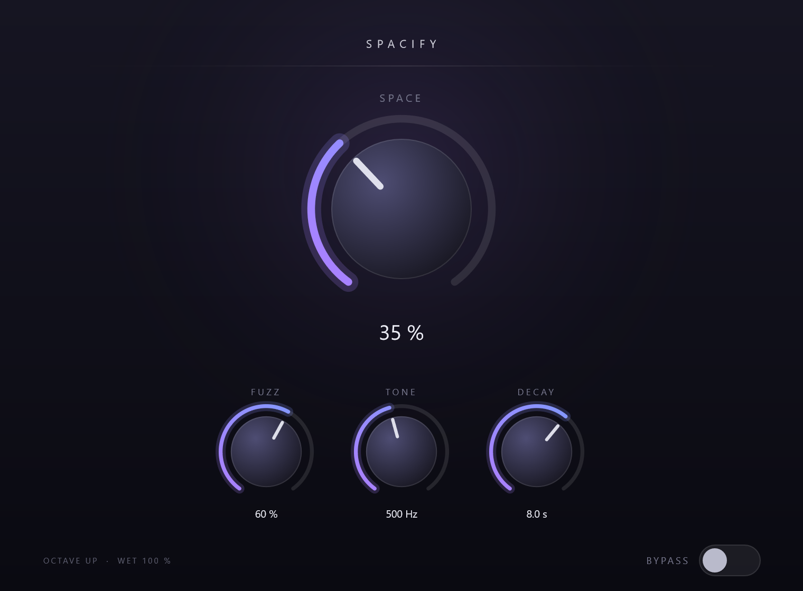

# Spacify

ドライ音はそのままに、**1 オクターブ上にピッチシフトしたファズのかかった残響レイヤー**を上から足す VST3 オーディオエフェクトです。

```
Input ──┬─────────────────────────────────────────────┬──> Output
        │                                             │
        └─> Pitch +12st ─> Fuzz ─> HPF ─> Reverb ─> ×SPACE
            (オクターブ上)   (tanh)   (12dB/oct) (100% wet)
```

出力は常に `Dry + SpaceLayer × SPACE` の**加算合成**です。SPACE を上げてもドライ音が小さくなることはありません。



---

## パラメータ

| パラメータ | 範囲 | 初期値 | 説明 |
|---|---|---|---|
| **SPACE** | 0 – 100 % | 35 % | レイヤーのミックス量。0 % では出力が入力と完全に一致します。 |
| **FUZZ** | 0 – 100 % | 60 % | ピッチシフト後のレイヤーに掛けるソフトクリップ歪みの強さ。 |
| **TONE** | 100 Hz – 4 kHz | 500 Hz | レイヤーに掛けるハイパスフィルタの遮断周波数（12 dB/oct）。 |
| **DECAY** | 0.5 – 20 s | 8 s | レイヤー残響の RT60。 |
| **BYPASS** | on / off | off | ホストのバイパスと連動します。 |

固定仕様（UI からは変更できません）:

- ピッチシフト量は常に **+12 semitones**
- テンポには一切追従しません（テンポ変更なし）
- リバーブは **100 % wet**（リバーブ内部にドライ成分はありません）
- プリディレイは **20 ms** 固定
- レイテンシは **0 サンプル**（下記参照）

---

## 動作仕様

- **SPACE = 0 %** … ウェット経路を完全にスキップし、出力は入力とビット一致します。
- **ドライは減衰しない** … レイヤーは加算されるだけです。SPACE を動かしてもドライのレベルは変化しません。
- **PDC（レイテンシ）** … ピッチシフタは遅延を読み飛ばす方式で先読みが無く、リバーブは純粋なフィードバック網なので、プラグインが報告するレイテンシは 0 です。ホスト側での補正は不要です。
- **モノラル対応** … ステレオ入出力が基本ですが、モノラル入出力（Mono → Mono）でも動作します。内部処理は常にステレオで行い、モノラル時はレイヤーの L 成分を加算します。
- **ホストサンプルレート** … ホストのサンプルレートで動作します（44.1 / 48 / 88.2 / 96 kHz で検証済み）。
- **精度** … float32 処理のみ（VST3 には kSample32 のみを通知します）。
- **オートメーション** … SPACE / FUZZ / TONE / DECAY / BYPASS のすべてがホストのオートメーションに対応します。
- **状態保存** … すべてのパラメータがプラグインのステートとして保存・復元されます。

---

## ビルド

### 必要なもの

- CMake 3.22 以上
- Visual Studio 2022（Community または Build Tools）＋「C++ によるデスクトップ開発」ワークロード
- Git（JUCE の取得に使用）

### 手順

```powershell
# 1. JUCE を取得（初回のみ・約 1 分）
git clone --depth 1 --branch 8.0.9 --recurse-submodules --shallow-submodules `
    https://github.com/juce-framework/JUCE.git external/JUCE

# 2. ビルド
./scripts/build.ps1
```

成果物は次の場所に出力されます。

```
build/Spacify_artefacts/Release/VST3/Spacify.vst3
```

VS 2022 が複数インストールされていて CMake が誤ったインスタンスを選ぶ場合は、
C++ ツールを持つインスタンスを明示してください。

```powershell
./scripts/build.ps1 -VsInstance "C:/Program Files (x86)/Microsoft Visual Studio/2022/BuildTools"
```

### インストール

`Spacify.vst3` フォルダーを VST3 の検索パスにコピーするだけです。

```powershell
Copy-Item -Recurse "build/Spacify_artefacts/Release/VST3/Spacify.vst3" `
          "$env:COMMONPROGRAMFILES\VST3\"
```

MSVC ランタイムは静的リンクしているため、追加のランタイムは不要です。

---

## リポジトリ構成

```
CMakeLists.txt           ビルド定義（既定では VST3 のみ。開発用ツールは -DSPACIFY_BUILD_TOOLS=ON）
scripts/build.ps1        CMake のラッパー
source/
  PluginInfo.h           プラグイン名・バージョン・固定仕様の定数
  PluginProcessor.*      AudioProcessor、パラメータ、ウェット経路の組み立て
  PluginEditor.*         UI のレイアウトと背景描画
  ui/
    SpacifyLookAndFeel.* ノブ／バイパストグルのベクター描画
    SpacifyKnob.*        ノブ + 名前 + 数値表示
  dsp/
    OctaveUpPitchShifter.h  +12st 固定のグラニュラーシフタ
    Fuzz.h                  tanh ソフトクリップ
    ToneHighPass.h          RBJ 2 次ハイパス
    SpaceReverb.h           RT60 指定の Freeverb 系リバーブ
    SmoothedParam.h         パラメータスムージング
tools/                   開発専用（製品には含まれません）
  DspTests.cpp           ヘッドレス DSP 検証
  RenderEditor.cpp       UI をオフスクリーンで PNG 出力
  pngcrop.mjs            PNG の拡大切り出し（UI 確認用）
external/JUCE            JUCE 8.0.9（git 管理外）
```

---

## 実装メモ

### ピッチシフタ（`OctaveUpPitchShifter`）

2 本の読み出しタップを入力バッファ上で 2 倍速で動かし、タップが折り返す瞬間を
Hann 窓でクロスフェードする古典的なグラニュラー方式です。タップが折り返す位置は
必ず窓がゼロになるため、折り返しの不連続は聞こえません。

先読みが無いのでレイテンシは 0 です。この方式は原理的に 1/grain 秒周期の
わずかな振幅リップル（最大 -3 dB）を持ちますが、後段のファズと長いリバーブで
完全に隠れるため、位相ボコーダよりトランジェントが残る本方式を採用しています。
グレイン長は 100 ms です。

### ファズ（`Fuzz`）

`tanh` による非対称ソフトクリップです。直流バイアスを加えてから非線形に入れ、
出力で同じ量を差し引くことで偶数次倍音も生成し、「シャリッとした」質感を得ています。
基準振幅（0.3）が歪み量によらず一定のレベルで出てくるよう正規化しているため、
FUZZ を上げてもレイヤーの音量は急激には変化しません。

### リバーブ（`SpaceReverb`）

Freeverb と同じ 8 コーム + 4 オールパスの構成ですが、コームのフィードバックを
`g = 10^(-3·T_comb / RT60)` として **RT60（秒）から直接計算**しているため、
DECAY をそのまま秒数として 20 秒まで正確に指定できます
（Freeverb の room size パラメータは 12 秒付近で飽和するため使えません）。

- 入力は `(1 - g)` で正規化しているので、DECAY を変えてもレイヤーの音量はほぼ一定です。
- コーム内のダンピングは意図的に浅く（0.05）しています。ループ利得が 1 に近いため、
  ダンピングを強くすると高い周波数だけが急速に減衰し、音がこもってしまうからです。
- プリディレイは 20 ms 固定です。

実測 RT60（ノイズバーストに対する T30 換算）:

| DECAY 設定 | 実測 |
|---|---|
| 0.5 s | 0.52 s |
| 3.0 s | 2.76 s |
| 8.0 s | 7.24 s |
| 20 s | 17.0 s |

---

## 検証

開発用ツールを有効にしてビルドすると、ホストに読み込まずに検証できます。

```powershell
./scripts/build.ps1 -WithTools

# ヘッドレス DSP 検証
./build/SpacifyDspTests_artefacts/Release/SpacifyDspTests.exe

# UI を PNG にレンダリング（第 2 引数は拡大率）
./build/SpacifyRenderEditor_artefacts/Release/SpacifyRenderEditor.exe ui.png 2
```

`SpacifyDspTests` が確認する内容:

- BYPASS が入力をビット一致で通過すること
- SPACE = 0 % が入力をビット一致で通過すること
- レイヤーが SPACE に比例して加算される（ドライが減衰しない）こと
- 220 Hz 入力に対してレイヤーの基本波が 440 Hz にあり、220 Hz 成分が消えていること
- FUZZ がレイヤーに高い次数の倍音を加えていること
- DECAY 0.5 / 3 / 8 / 20 秒の実測 RT60
- 無音入力に対して完全な無音が出力されること（デノーマル蓄積なし）
- 最大設定・フルスケール入力でも有限かつ有界であること
- モノラル入出力、44.1 / 88.2 / 96 kHz での動作
- ステートの保存・復元

さらに `pluginval`（strictness level 8）で以下を含む全項目を通過しています。

```
pluginval.exe --strictness-level 8 --validate "build/Spacify_artefacts/Release/VST3/Spacify.vst3"
> SUCCESS
```

---

## 既知の制限

- ピッチシフトは固定で 1 オクターブ上のみです（UI から変更できません）。
- ステレオ入力はそのままステレオで処理されますが、レイヤーのピッチシフタと
  リバーブは左右独立ではなく共通の設定で動作します（左右で異なる設定はありません）。
- モノラル入出力では内部的にステレオ処理を行うため、SPACE を上げると
  レイヤーの L 成分のみが加算されます。
